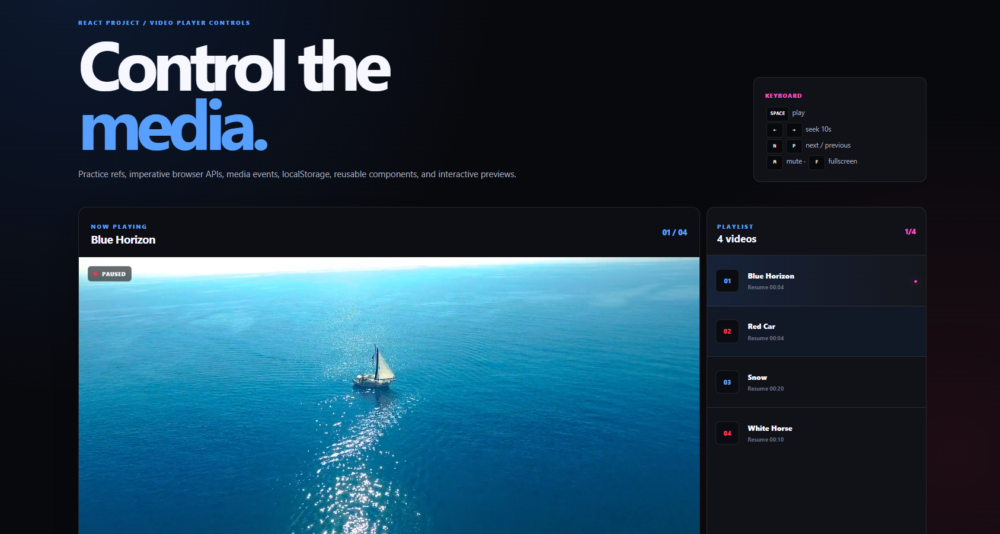
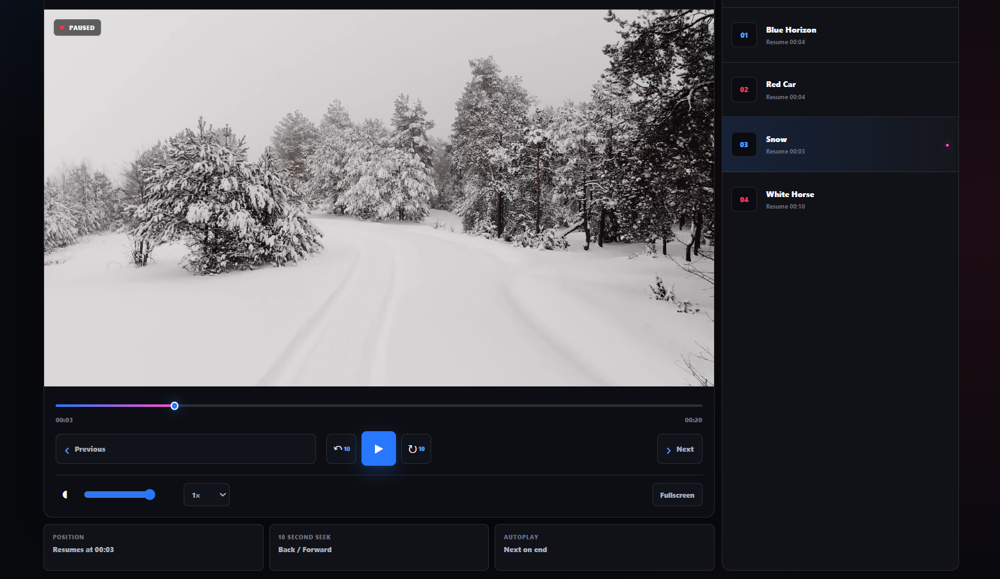

# Project — Video Player Controls (Updated)





Theme: **Blue + White + Red + Black + Pink**

## Run

```bash
npm install
npm run dev
```

## What's included

1. Multiple local videos
2. Previous / Next video controls
3. Automatic next video when the current video ends
4. 10-second back and forward seeking
5. Last playback position saved in localStorage
6. Timeline hover frame preview
7. Previous/next button hover preview
8. Reusable React components
9. Playback speed
10. Volume + mute
11. Fullscreen
12. Keyboard controls
13. Responsive UI

## Video files

The project includes four tiny generated demo videos:

```text
public/videos/video-01.mp4
public/videos/video-02.mp4
public/videos/video-03.mp4
public/videos/video-04.mp4
```

Replace these files with your own MP4 files while keeping the same names, or update `VIDEO_LIST` in `src/App.jsx`.

For example:

```js
const VIDEO_LIST = [
  {
    id: "intro",
    title: "Introduction",
    src: "/videos/intro.mp4",
    accent: "blue",
  },
  {
    id: "hooks",
    title: "React Hooks",
    src: "/videos/hooks.mp4",
    accent: "pink",
  },
];
```

## 10-second seek

The reusable `SeekButton` component is used for both directions:

```js
seekRelative(-10);
seekRelative(10);
```

Keyboard:

```text
←  back 10 seconds
→  forward 10 seconds
```

## localStorage playback position

Each video gets its own key inside one JSON object:

```text
video-positions
```

Example:

```json
{
  "video-01": 84.2,
  "video-02": 31.8
}
```

This means switching videos does not overwrite the other video's progress.

## Timeline hover thumbnails

`VideoTimeline` calculates the hovered timestamp.

`useVideoThumbnail` then:

1. seeks the video to the hovered timestamp,
2. draws that frame to a canvas,
3. converts it into a small JPEG data URL,
4. displays it above the timeline.

This is why the preview is a real frame from the video rather than a static image.

For local videos this works without extra configuration. If you later use videos from another domain, canvas security/CORS rules can prevent frame capture.

## Previous / next thumbnails

The current implementation displays a preview card containing the corresponding next/previous video source.

For production-quality thumbnail previews, add poster images to `VIDEO_LIST`:

```js
{
  id: "video-02",
  title: "React Basics",
  src: "/videos/react-basics.mp4",
  poster: "/thumbnails/react-basics.jpg"
}
```

Then use the poster in `NavigationButton`.

## Reusable component architecture

The player is split into:

```text
App
├── PlayButton
├── SeekButton
├── NavigationButton
├── VideoTimeline
├── VolumeControl
├── PlaybackSpeed
└── Playlist
```

This makes individual controls easier to test, modify, and reuse.

## Keyboard shortcuts

```text
Space / K  Play / Pause
←          Back 10 seconds
→          Forward 10 seconds
N          Next video
P          Previous video
M          Mute
F          Fullscreen
```

## Learning challenges

### Beginner
Add 5 more videos.

### Intermediate
Add a `poster` property to every video.

### Intermediate
Add a progress percentage beside every playlist item.

### Advanced
Create a separate `VideoPlayer` component and pass the playlist through props.

### Advanced
Move the video list into a JSON file.

### Advanced
Add Picture-in-Picture.

### Advanced
Add captions with `<track>`.

### Advanced
Add playback quality selection.

### Advanced
Add watch history.

### Advanced
Build a custom hook:

```js
useVideoPlayer(videoRef)
```

and move the imperative video logic out of `App.jsx`.

The goal is to understand why refs are useful for imperative media APIs while React state remains responsible for the UI.
